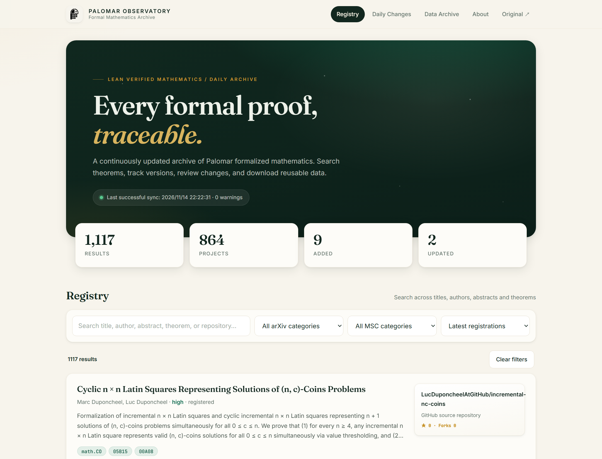

# Palomar Registry Daily Dashboard

[中文说明](README.zh-CN.md) · **English**



A continuously updated archive of [Palomar Registry](https://palomar-registry.org) formal mathematics results. GitHub Actions fetches the registry once a day, validates and stores JSON snapshots, optionally syncs result versions to Notion, and publishes a searchable dashboard to GitHub Pages.

**Live site:** <https://2404589803.github.io/palomar-registry-daily/>

## What it does

- Fetches `/api/v1/results` (following pagination until the full dataset validates), plus `/recent.json` and `/recent-renders.json`
- Stores a dated snapshot in `data/snapshots/YYYY-MM-DD/`; the dashboard reads `data/latest.json`
- Keeps per-result versions, entries, thumbnails and repository metadata under `data/`
- Optionally upserts every result version into Notion and persists page IDs in `data/notion-sync-state.json`
- Deploys the static site to GitHub Pages on every run

## Use

1. Push this directory to a GitHub repository.
2. In **Settings → Pages**, choose **GitHub Actions** as the source.
3. The workflow (`.github/workflows/daily.yml`) runs daily at **02:15 UTC** and can also be dispatched manually.

## Notion sync (optional)

The daily workflow can mirror every result version into a Notion database.

- Add a `NOTION_TOKEN` GitHub Actions secret for an integration with access to that database.
- Add the database ID as a `NOTION_DATABASE_ID` secret; it is not stored in the repository.
- Synced page IDs are stored in `data/notion-sync-state.json`.

Transient Notion failures are retried and do not block the data snapshot or the Pages deployment.

## Repository layout

```
index.html archive.html changes.html result.html about.html   dashboard pages
app.js pages.js style.css                                     frontend
data/                                                         snapshots, latest.json, entries, versions
scripts/fetch_palomar.py                                      fetch + validate
scripts/sync_notion.py                                        Notion upsert
.github/workflows/daily.yml                                   scheduled job
docs/screenshot.png                                           dashboard screenshot
```
