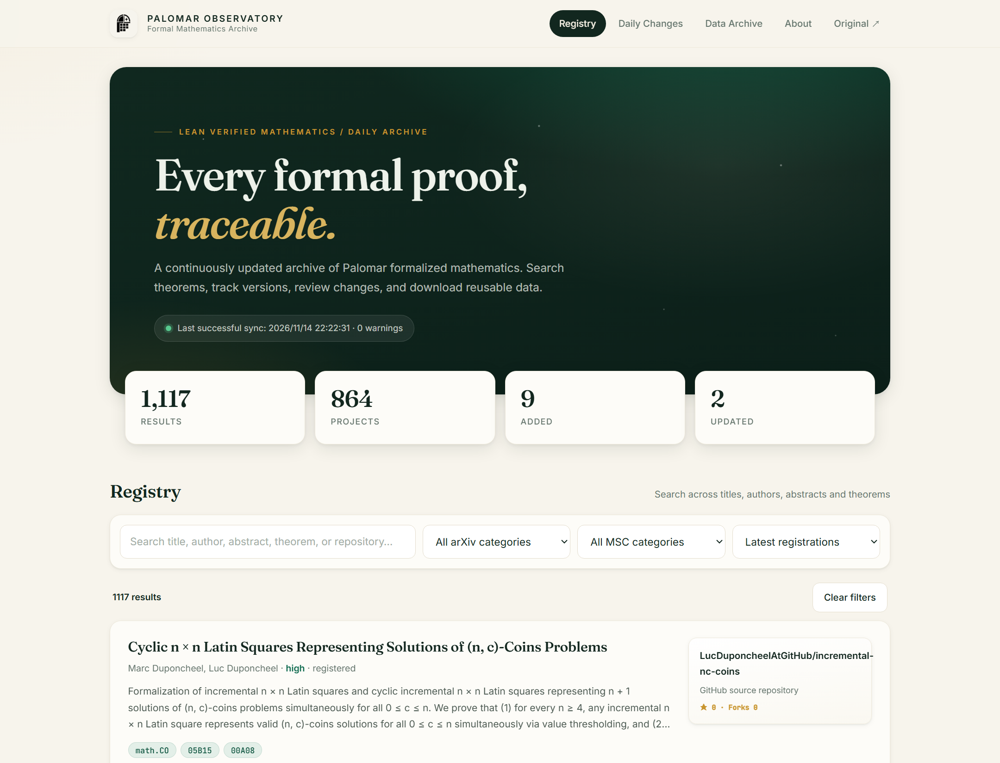

# Palomar Registry 每日归档面板

[English](README.md) · **中文**



本项目持续归档 [Palomar Registry](https://palomar-registry.org) 中的形式化数学结果。GitHub Actions 每天抓取一次，校验并保存 JSON 快照，可选地把结果版本同步到 Notion，并把可检索的面板发布到 GitHub Pages。

**在线站点：** <https://2404589803.github.io/palomar-registry-daily/>

## 功能

- 抓取 `/api/v1/results`（按分页读取，直到完整数据通过校验），以及 `/recent.json` 和 `/recent-renders.json`
- 将当日快照保存到 `data/snapshots/YYYY-MM-DD/`；面板读取 `data/latest.json`
- 在 `data/` 下维护每条结果的版本、条目、缩略图和仓库元数据
- 可选：把每个结果版本写入 Notion，并把页面 ID 记录在 `data/notion-sync-state.json`
- 每次运行都把静态站点部署到 GitHub Pages

## 使用方法

1. 将此目录推送到 GitHub 仓库。
2. 在 **Settings → Pages** 中选择 **GitHub Actions** 作为发布来源。
3. 工作流 `.github/workflows/daily.yml` 每天 **UTC 02:15** 自动运行，也可以手动触发。

## Notion 同步（可选）

每日工作流可以把每个结果版本写入一个 Notion 数据库。

- 添加一个能访问该数据库的集成令牌，保存为 GitHub Actions Secret：`NOTION_TOKEN`
- 数据库 ID 保存为另一个 Secret：`NOTION_DATABASE_ID`，不写进仓库
- 同步过的页面 ID 保存在 `data/notion-sync-state.json`

Notion 的瞬时故障会自动重试，不会阻断每日快照和 Pages 部署。

## 目录结构

```
index.html archive.html changes.html result.html about.html   面板页面
app.js pages.js style.css                                     前端
data/                                                         快照、latest.json、条目、版本
scripts/fetch_palomar.py                                      抓取 + 校验
scripts/sync_notion.py                                        Notion 写入
.github/workflows/daily.yml                                   定时任务
docs/screenshot.png                                           面板截图
```
